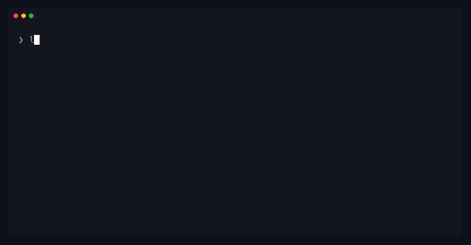
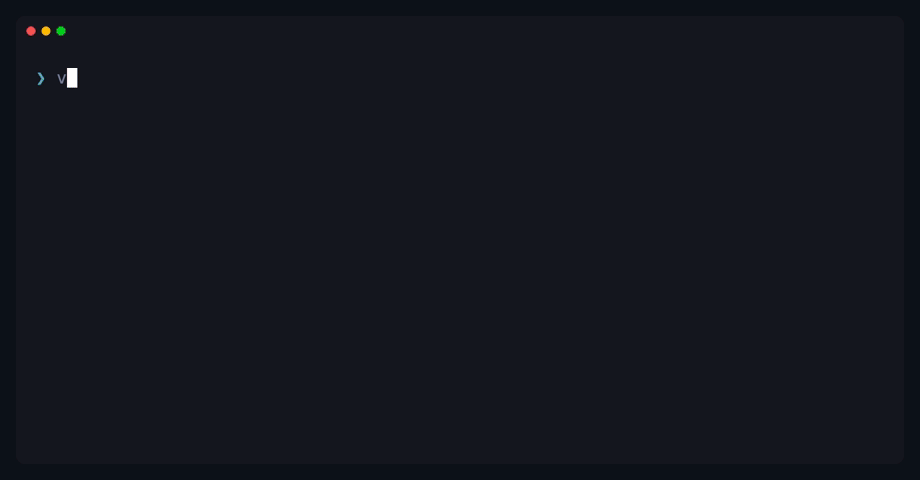

<div align="center">

# maketex

[](https://github.com/sean-stapleton-doyle/maketex/actions/workflows/ci.yml)
[](https://github.com/sean-stapleton-doyle/maketex/releases/latest)
[](LICENSE)

A fast, zero-config C++ replacement for `latexmk`. Run `maketex` in any LaTeX folder, no flags or setup needed. If you need a custom workflow, or want to see what `maketex` is capable of, please see [examples/](examples/) for multi-chapter projects, custom tools, and advanced configs.

<br />



</div>

## Install

```sh
# Homebrew (macOS & Linux)
brew install sean-stapleton-doyle/tap/maketex

# Shell installer (macOS & Linux)
curl -fsSL https://raw.githubusercontent.com/sean-stapleton-doyle/maketex/main/scripts/install.sh | sh
```

Prebuilt `.deb`, `.rpm`, and `.tar.gz` packages are on [GitHub Releases](https://github.com/sean-stapleton-doyle/maketex/releases). To build from source (C++26, CMake 3.25+):

```sh
make release && make install PREFIX=/usr/local
```

## Quick start

```sh
cd my-paper
maketex                    # build once and publish main.pdf
maketex --preamble-cache   # cache pdflatex preamble (.fmt) for faster edits
maketex watch              # rebuild on save (kqueue / inotify)
maketex doctor             # check engines, tools, and packages
maketex clean              # remove aux files (keep PDF; --all removes everything)
```

## Features

- **Zero config**: finds the root `.tex` file, selects `pdflatex` / `xelatex` / `lualatex`, and runs tools until the build converges.
- **Clean project root**: stores `.aux`, `.log`, `.fls`, and `.bbl` files in `.maketex/` and copies the PDF beside your `.tex` file.
- **Fast rebuilds**: tracks inputs with BLAKE3 hashes in SQLite, skips unchanged runs, runs independent tools in parallel, and supports `-draftmode`, XeLaTeX `-no-pdf`, and `--preamble-cache`.
- **Built-in tools**: `biber`, `bibtex`, `makeindex`, `nomencl`, `makeglossaries`, `bib2gls`, `pythontex`, plus custom `[[tool]]` rules.
- **Auto-install**: installs missing TeX Live packages in one batched `tlmgr` call.
- **CI ready**: outputs `--format=json`, `--format=github` PR annotations, and configurable warning policies.

## Diagnostics

`maketex` parses TeX and tool logs to show the exact file, line, and source snippet:

<div align="center">



</div>

## Watch mode

`maketex watch` uses native OS events (`kqueue` / `inotify`) to rebuild on save in a full-screen TUI:

<div align="center">


</div>

## Comparison

| Feature | `maketex` | `latexmk` | `tectonic` |
|---|---|---|---|
| Standard TeX Live (`pdflatex`, `xelatex`, `lualatex`) | Yes | Yes | Custom XeTeX engine |
| Full tool ecosystem (`minted`, `pythontex`, `biber`, TikZ) | Yes | Yes | Partial |
| Hidden aux directory by default | Yes (`.maketex/`) | No | Yes |
| Compiler-style diagnostics | Yes | Raw TeX log | Improved |
| Content-hash cache + parallel tools | Yes | MD5, sequential | Content-based |
| Precompiled preamble `.fmt` cache | Yes | No | No |
| Native file watch (`kqueue` / `inotify`) | Yes | Polling (`-pvc`) | No |
| Runtime dependency | Single binary | Perl | Single binary |

## Documentation

- [Examples](examples/) — minimal, multi-chapter thesis, TikZ, XeLaTeX, and custom `[[tool]]` projects
- [Usage guide](docs/USAGE.md)
- [Editor setup](docs/editors.md) — VS Code, Neovim, Zed, Emacs, TeXstudio
- [Configuration (`maketex.toml`)](docs/configuration.md)
- [CI guide](docs/ci.md)
- [Packaging & releases](docs/packaging.md)
- [Architecture](docs/architecture.md) · [Roadmap](docs/next-up.md)

## License

[MIT](LICENSE)
