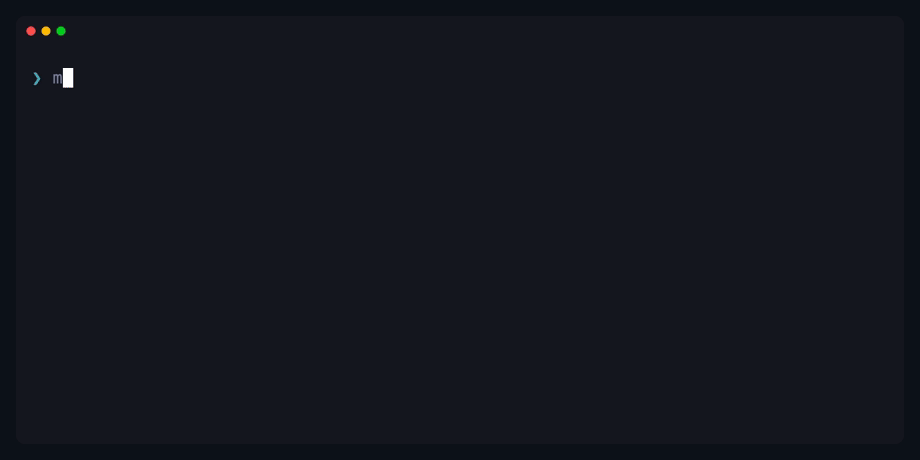

<div align="center">

# maketex

[](https://github.com/sean-stapleton-doyle/maketex/actions/workflows/ci.yml)
[](https://github.com/sean-stapleton-doyle/maketex/releases/latest)
[](LICENSE)


A modern, zero-config C++ replacement for `latexmk`. Run `maketex` in a LaTeX project and it finds the root document, picks the right engine, drives auxiliary tools until convergence, hides build clutter in `.maketex/`, installs missing TeX Live packages, and prints clean compiler-style diagnostics.

<br />


</div>

## Quick start

```sh
cd my-paper
maketex                 # compile once; publishes main.pdf beside main.tex
maketex --preamble-cache # cache precompiled pdflatex preamble (.fmt) for faster body edits
maketex watch           # rebuild instantly on source or .bib edits (kqueue / inotify)
maketex doctor          # check your TeX engines, tools, and document packages
maketex clean           # remove aux files (keep PDF); add --all for a pristine tree
```

## Compiler-style diagnostics

Instead of dumping hundreds of lines of raw TeX logs, `maketex` parses engine and auxiliary tool logs to point straight at the offending file, line, and source snippet:

<div align="center">


</div>

## Live watch mode

`maketex watch` uses native OS file notifications (`kqueue` on macOS, `inotify` on Linux) to rebuild immediately on save and show live diagnostics in a full-screen TUI:

<div align="center">



</div>

## Key features

- **Zero-touch defaults**: discovers the root `.tex` file (skipping `subfiles` chapters and following `% !TEX root`), detects `pdflatex` / `xelatex` / `lualatex` (including TikZ `graphdrawing` and automatic fallback for class-hidden Unicode requirements), and keeps intermediate files inside a `.gitignore`'d `.maketex/` folder.
- **Fast incremental & multi-pass builds**:
  - Tracks inputs via `-recorder` (`.fls`) and BLAKE3 content hashes in SQLite so unchanged builds exit immediately (`✓ up to date`) and edits run only the passes and tools actually needed.
  - Speeds up multi-pass builds with cold pass-1 `-draftmode` (`pdflatex`/`lualatex`), XeLaTeX `-no-pdf` with a single `xdvipdfmx` finalization pass, and parallel execution of independent auxiliary tools.
  - Optional precompiled preamble `.fmt` caching (`--preamble-cache` / `preamble-cache = true`) for `pdflatex` with exact `file:line` error attribution and automatic invalidation on preamble edits.
  - Native OS file watching (`kqueue` on macOS, `inotify` on Linux) in `maketex watch`.
- **Built-in auxiliary tools**: `biber`, `bibtex`, `makeindex`, `nomencl`, `makeglossaries` (including custom glossary types), `bib2gls`, and `pythontex`.
- **Automatic package installation**: on TeX Live (MacTeX / BasicTeX), batches missing preamble packages into a single `tlmgr install` (confirming before `sudo` on root-owned trees).
- **Clean diagnostics & CI support**: compiler-style terminal output with source snippets, `--format=json`, `--format=github` PR annotations, and configurable warning policies (`--warnings-as-errors`, `fail-on`, `ignore`).
- **Powerful `maketex.toml` configuration**: declarative custom tools (`[[tool]]`), `texinputs`/`bibinputs`/`[env]`, `[content-filters]`, `[diagnostics]`, `preamble-cache`, and `jobname`.

## Comparison

| Feature | `maketex` | `latexmk` | `tectonic` |
|---|---|---|---|
| Uses standard TeX Live (`pdflatex`, `xelatex`, `lualatex`) | Yes | Yes | Own XeTeX-derived engine |
| Full package & tool ecosystem (`minted`, `pythontex`, `biber`, `bib2gls`, TikZ) | Yes | Yes | Partial (no LuaTeX / shell-escape tools) |
| Zero-config engine & root file detection | Yes | Manual flags / `.latexmkrc` | Single engine |
| Keeps `.aux`/`.fls`/`.log` clutter out of project root by default | Yes (`.maketex/`) | No (needs `-outdir` + workarounds) | Yes |
| Compiler-style diagnostics with source snippets | Yes | Raw TeX log output | Improved |
| Content-hash incremental builds (BLAKE3 + SQLite) | Yes | MD5 + mtime | Content-based |
| Multi-pass speedups (cold `-draftmode`, XeLaTeX `-no-pdf` split, parallel tools) | Yes | `-no-pdf` only | Single-engine |
| Precompiled preamble `.fmt` caching with exact `file:line` errors | Yes (`--preamble-cache`) | No | No |
| Native OS file watching (`kqueue` / `inotify`) | Yes (`maketex watch`) | Polling (`-pvc`) | No built-in watch |
| Automatic TeX Live package installation (`tlmgr`) | Yes (batched) | No | Auto-downloads own bundle |
| CI output (`--format=json`, `--format=github` PR annotations, warning policies) | Yes | No | No |
| Runtime dependencies | Single native binary | Perl | Single native binary |

## Installation

### Homebrew (macOS & Linux)

```sh
brew install sean-stapleton-doyle/tap/maketex
```

### Install script (macOS & Linux)

Downloads the latest release archive for your OS/architecture, verifies its SHA-256 checksum, and installs `maketex` into `~/.local/bin`:

```sh
curl -fsSL https://raw.githubusercontent.com/sean-stapleton-doyle/maketex/main/scripts/install.sh | sh
```

### Arch Linux (AUR)

```sh
yay -S maketex-bin
# or
paru -S maketex-bin
```

### Prebuilt binaries

Download the archive for your platform (`macos-arm64`, `macos-x86_64`, `linux-x86_64`, or `linux-arm64`) from [GitHub Releases](https://github.com/sean-stapleton-doyle/maketex/releases), extract it, and place `bin/maketex` on your `PATH`.

### Building from source

Requires a C++26-capable compiler (Clang / GCC 14+), CMake 3.25+ (newer CMake on GCC 14+ for C++26), and Ninja or Make. Dependencies are fetched automatically via CPM.

```sh
make release                                # build optimized Release binary
make install PREFIX=/usr/local              # install stripped `maketex` binary
```

Run tests:

```sh
make test                                   # full suite (unit + integration + e2e)
make test-unit                              # fast unit tests only
make help                                   # list all Makefile targets (format, release, tag-release, ...)
```

*(You can also invoke CMake directly: `cmake -S . -B build -G Ninja -DCMAKE_BUILD_TYPE=Release && cmake --build build && cmake --install build --component maketex`.)*

## Documentation

- [Usage guide](docs/USAGE.md)
- [Editor integrations](docs/editors.md) — VS Code (LaTeX Workshop), Neovim (VimTeX), Zed, Emacs (AUCTeX), TeXstudio
- [Configuration (`maketex.toml`)](docs/configuration.md)
- [CI integration](docs/ci.md)
- [Packaging & distribution](docs/packaging.md)
- [Architecture](docs/architecture.md)
- [API & sandboxing design](docs/api_and_sandboxing_design.md)
- [Known gaps & roadmap](docs/next-up.md)

## License

`maketex` is released under the [MIT License](LICENSE).
